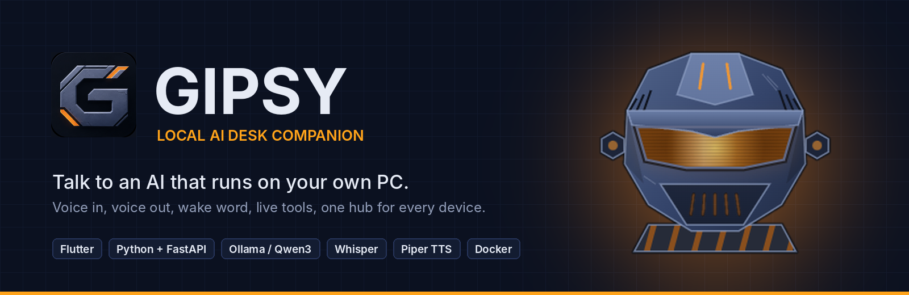
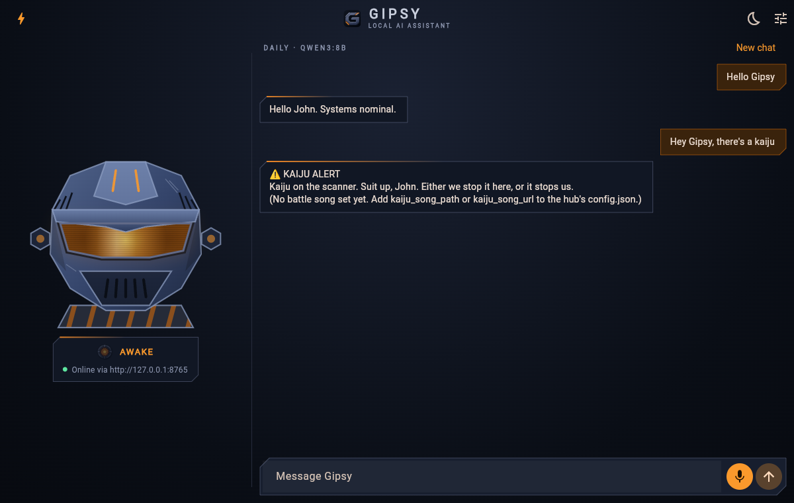
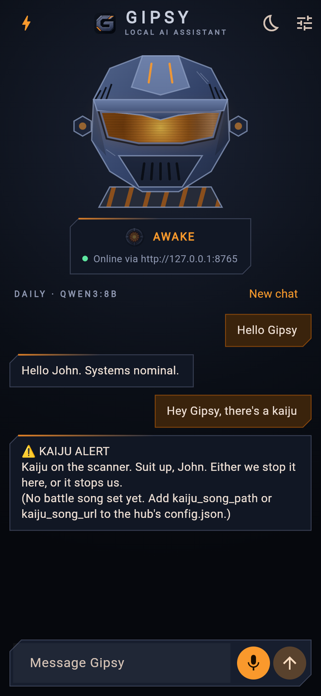
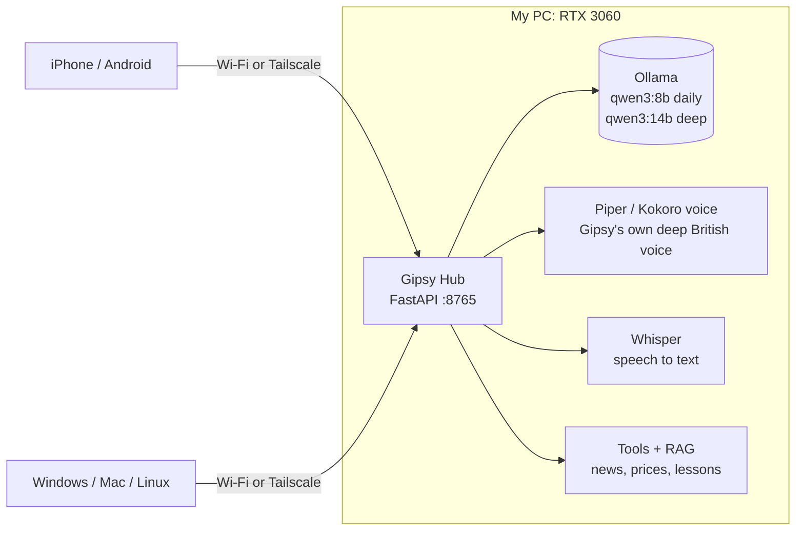
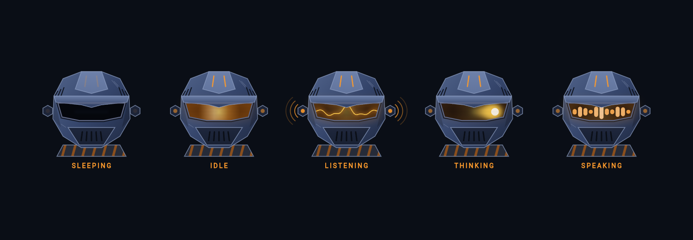
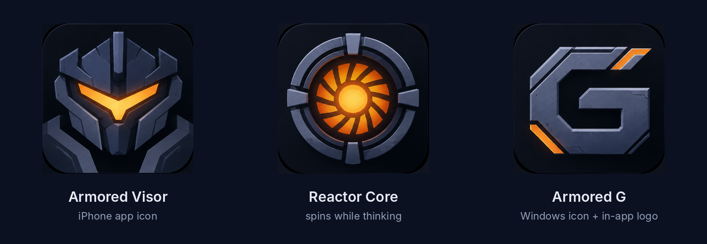
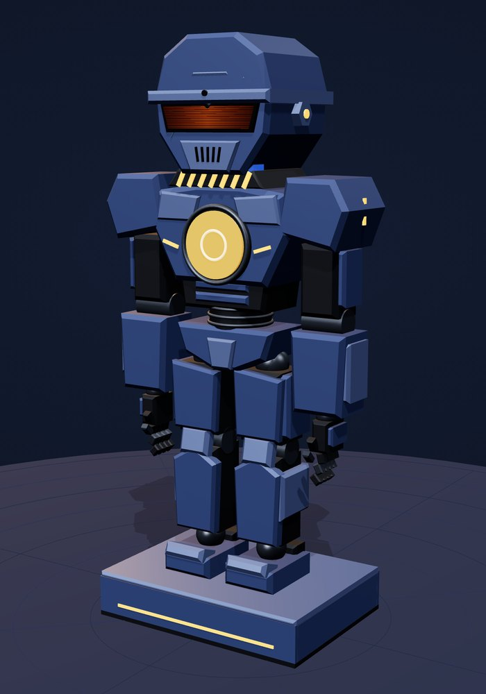
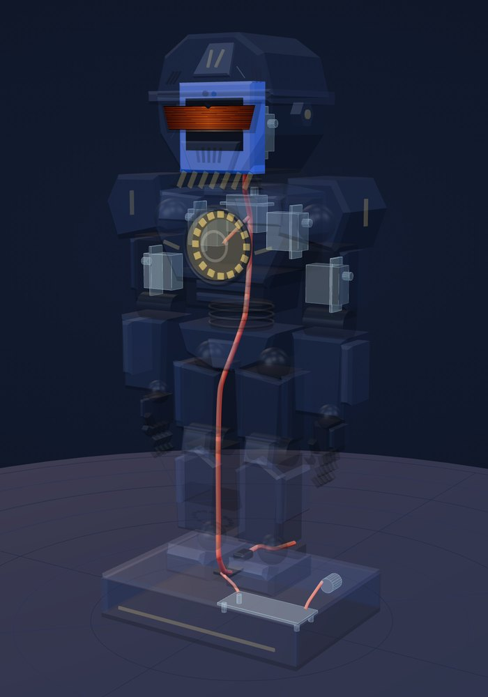

<p align="center">
  
</p>

<p align="center">
  <b>A voice assistant that runs entirely on my own PC</b>, with native apps for Windows, iPhone, Android, Mac and Linux, and a 3D-printable desk robot to live in.
</p>

<p align="center">
  
  
  
  
  
</p>

<table>
  <tr>
    <td width="68%"></td>
    <td width="32%"></td>
  </tr>
  <tr>
    <td align="center"><sub>Windows app</sub></td>
    <td align="center"><sub>iPhone app</sub></td>
  </tr>
</table>

Gipsy is a real installed app (not a website) that talks to the AI running on your own PC. One codebase builds for **Windows (desktop + laptop), iPhone, Android, Mac and Linux**.



* **gipsy_app/** is one Flutter app that builds for every platform.
* **gipsy_hub/** is a small Python server on your PC. The apps only talk to the hub, and Ollama stays private.
* **Run it two ways:** the simple Windows scripts below, or the whole stack in Docker with one command ([docs/DOCKER.md](docs/DOCKER.md)).
* Everything is free, and everything runs on your hardware.

## What the app does

| Feature | How |
|---|---|
| Chat | Type or talk. Replies stream in word by word. |
| Voice out | Gipsy's own deep, warm, gravelly British voice, made on the PC by reshaping stock voices (pitch, pace, warmth, grit). Pick from several in Settings > Voice, with a preview button. Gipsy starts talking after the first phrase, without waiting for the whole answer. See [docs/VOICE.md](docs/VOICE.md). |
| Voice in | Tap the visor or the mic. Whisper on the PC writes down what you said. |
| "Hey Gipsy" | While the app is open, Gipsy sleeps with its visor dark. Say "Hey Gipsy" and the visor turns orange. "Hey Gipsy, what's 12 times 9?" works in one go. |
| Conversation mode | After answering, Gipsy listens for a follow-up. If you stay quiet it goes back to sleep. |
| Brains | Use the bolt menu (top left) to switch between **Daily** (qwen3:8b, fast) and **Deep** (qwen3:14b, which thinks first). Any other model in Ollama shows up there too. |
| Kaiju alert | Say **"Hey Gipsy, there's a kaiju"**. Gipsy says a battle line in its own voice, then plays your battle song (slowed) while the visor pulses to the beat. Tap the visor to stop it. |
| Home and away | The app tries your home Wi-Fi address first, then your Tailscale address. |

### Visor states



| State | Look |
|---|---|
| Waking up | Cinematic boot: the visor flickers, a scan line sweeps down, the side pods light one by one and HUD brackets snap in |
| Sleeping | The glow collapses to a line and a dot like an old TV, then a faint standby line breathes |
| Awake | Solid orange glow with a slow shimmer |
| Listening | A live waveform that follows your voice, with sound rings at the ears |
| Thinking | A scanner light that sweeps side to side. The Reactor Core logo spins. |
| Speaking | Equaliser bars that bounce in time with the actual audio |
| Kaiju alert | The visor strobes red, the head shakes, and the rings spin up |

Behind the head, holographic rings turn slowly and embers drift upward. The rings spin faster while Gipsy thinks, and the scene flashes on every mode change.



Logos: the **Armored Visor** is the iPhone icon, the **Armored G** is the Windows icon and the in-app logo, and the **Reactor Core** spins while Gipsy is thinking.

## The desk bot

<table>
  <tr>
    <td></td>
    <td></td>
  </tr>
  <tr>
    <td align="center"><sub>Assembled: 344 mm (13.5 in) on its plinth</sub></td>
    <td align="center"><sub>X-ray: StackChan core in the head, cable route down to the plinth</sub></td>
  </tr>
</table>

The physical Gipsy is an original armored desk robot wearing the same helmet as the app. The head holds a StackChan-style core (screen, mic, speaker) whose visor shows the same five states, with room for MG90S servos so the head and arms can move later. The body is meant to be printed by a print service.

---

## This week's tasks

Tap the **calendar icon** in the app, or just ask: *"Hey Gipsy, what's due this week?"*, *"Am I free Thursday?"*, *"Add a task: chem lab report due Friday"*, *"I finished the chem lab report."*

Gipsy combines:
* **Your calendars:** any iCal (`.ics`) link. The easy way: on the **This week** screen tap the **link icon**, paste the link and pick School or Appointments. Gipsy tests the link straight away. Or paste them into `gipsy_hub/config.json` and restart the hub:
  ```json
  "calendars": [
    {"name": "School", "url": "https://<your school calendar feed>.ics", "kind": "school"},
    {"name": "Personal", "url": "https://calendar.google.com/calendar/ical/.../basic.ics", "kind": "appointment"}
  ]
  ```
  * **Google Calendar:** Settings → pick the calendar → *Integrate calendar* → copy **Secret address in iCal format**.
  * **Moodle / Open LMS:** Calendar → *Import or export calendars* → *Export calendar* → Events to export: **All courses** (or *All events*), Time period: **Recent and next 60 days** → *Get calendar URL* → copy the link. Pick **School** when you link it.
  * **Canvas:** Calendar → *Calendar Feed* (bottom right) → copy the link. Schoology and most school systems have a similar "iCal feed" or "subscribe" link.
  * **Outlook:** Settings → Calendar → Shared calendars → *Publish a calendar* → copy the ICS link.
  * **iPhone/iCloud:** in the Calendar app, tap ⓘ next to a calendar → *Public Calendar* → share the link.

  These links are private. They live only on your PC (`config.json`, or `calendars.json` for links added in the app), which are never uploaded to GitHub, and the app only ever shows them masked.
* **Your to-do list:** saved on the PC in `gipsy_hub/tasks.json`. Add or tick off tasks by voice or in the app.
* **Market events:** built in are US stock market holidays, 1 PM early closes, and monthly options expiry (quadruple witching in March, June, September and December), worked out from the exchange's rules so they never go stale. Fed meetings, CPI and jobs reports, and earnings for the stocks you follow come from the markets module.

  Running the hub in Docker? Use `docker-data/hub/config.json` instead; `tasks.json` and `calendars.json` are saved in that same folder.

---

## Option A: Run the AI stack in Docker (recommended)

Each piece runs in its own container, so you can start, stop, update or wipe it without touching the rest of the PC. Ollama stays a normal Windows app so it keeps the GPU.

```powershell
copy .env.example .env
docker compose up -d                   # Gipsy Hub + Open WebUI
docker compose --profile home up -d    # ...plus Home Assistant
```

| Service | Address | What it is |
|---|---|---|
| Gipsy Hub | `http://<PC's Wi-Fi IP>:8765` | What the Gipsy apps connect to |
| Open WebUI | http://localhost:3000 | ChatGPT-style page for every Ollama model |
| Home Assistant | http://localhost:8123 | Optional, for the smart plug and lamp |

The step-by-step guide for first-time Docker users (installing Docker Desktop, PowerShell commands, where your data lives, firewall, troubleshooting) is in **[docs/DOCKER.md](docs/DOCKER.md)**.

## Option B: Set up Gipsy Hub on the PC without Docker (about 15 minutes, one time)

1. Install **Python 3.12** from python.org. On the first screen, tick **"Add python.exe to PATH"**.
2. Copy the `gipsy_hub` folder somewhere permanent, for example `D:\Gipsy\gipsy_hub`.
3. Double-click **`install_hub.bat`**. It installs everything into a private folder and opens port 8765 on your *private* network only. Say yes to the admin prompt.
4. Make sure the **Ollama** app is running, then pull the models if you haven't yet:
   ```
   ollama pull qwen3:8b
   ollama pull qwen3:14b
   ```
5. Double-click **`start_hub.bat`**. The first start downloads the voice (about 60 MB) and the Whisper model (about 150 MB). The window prints your addresses:
   ```
   On this PC:      http://127.0.0.1:8765
   On your Wi-Fi:   http://192.168.x.x:8765   <- put this in the app as "Home Wi-Fi"
   ```
6. **Tailscale** (for use away from home): install Tailscale on the PC and the iPhone and sign in with the same account. In the Tailscale tray icon, copy the PC's `100.x.y.z` address. In the app, enter it as `http://100.x.y.z:8765`.
7. **Optional:** to start the hub automatically at login, press Win+R, type `shell:startup`, and put a shortcut to `start_hub_hidden.vbs` in that folder. Its log goes to `hub.log`.

**Kaiju alert song:** the song isn't included in the code, because the repo is public. Put an audio file you own on the PC, for example `D:\\Music\\battle-song.mp3`, and set it in `config.json`:
```json
"kaiju_song_path": "D:\\Music\\battle-song.mp3",
"kaiju_song_rate": 0.85
```
`0.85` plays it slowed. Use `1.0` if your file is already a slowed version.

**Or use a link instead of a file:** leave `kaiju_song_path` empty and set `kaiju_song_url` to a YouTube or Spotify link. After the battle line, the app opens the link in the YouTube or Spotify app, or in your browser:
```json
"kaiju_song_path": "",
"kaiju_song_url": "https://www.youtube.com/watch?v=..."
``` You can change what Gipsy says with `kaiju_line`. Restart the hub after editing.

**Settings** live in `gipsy_hub/config.json`, which is created on the first run:
* `home_location`: your city for weather questions, e.g. `"Oklahoma City"` (empty = Gipsy asks).
* `voice_preset`: `commander` by default. See [docs/VOICE.md](docs/VOICE.md) for every voice and how to fine-tune pitch, pace, warmth and grit.
* `daily_model` / `deep_model`: which Ollama models to use.
* `whisper_model`: `base.en` (fast) or `small.en` (more accurate).
* `api_key`: set any password here and enter the same one in the app.

## Part 2: Get the apps

The apps are compiled on GitHub's free cloud machines. That way you don't need a Mac or Visual Studio. You need a GitHub repository for this. Claude can set it up when you say go.

1. Put this folder in a GitHub repo (private is fine).
2. Open the repo's **Actions** tab, choose **Build Gipsy apps**, and click **Run workflow**. A run takes about 10 to 15 minutes.
3. Download what you need from the bottom of the finished run:

| Device | File | Install |
|---|---|---|
| Windows PC or laptop | gipsy-windows | Unzip and run `gipsy.exe` (see below) |
| iPhone / iPad | gipsy-ios-unsigned | Sideloadly (see below) |
| Android phone or tablet | gipsy-android | Open the `.apk` on the phone and allow "Install unknown apps" once. No re-signing. |
| Mac | gipsy-mac | Unzip, drag to Applications, then right-click → Open the first time (it's unsigned) |
| Linux | gipsy-linux | Extract and run `./gipsy` (needs `pulseaudio-utils` for the mic) |

> A private repo gets 2,000 free Action minutes a month. Mac minutes count 10×, so each iPhone build uses about 100 of them. That's enough for roughly 15 iPhone builds a month. A public repo has no limit.

### Windows

1. Unzip `Gipsy-Windows.zip` to `D:\Gipsy\app`.
2. Run `gipsy.exe`. If SmartScreen appears, click "More info" and then "Run anyway". This happens because the app isn't code-signed.
3. Right-click it in the taskbar and choose **Pin to taskbar**.
4. Open Settings (the sliders icon). On the PC that runs the hub, set Home Wi-Fi to `http://127.0.0.1:8765`.

**On a laptop or any other device:** use the hub PC's Wi-Fi address (for example `http://192.168.1.50:8765`) as Home Wi-Fi, and its Tailscale address as the second one. Install Tailscale on that device too, so it works away from home. Every device talks to the same Gipsy on your PC.

### iPhone (free Apple ID, no developer account)

Apple only lets a free Apple ID install your own app for **7 days at a time**. After that it needs a re-sign, which takes one click.

1. On the PC, install **Sideloadly** (sideloadly.io) and **iTunes from apple.com** (not the Microsoft Store version).
2. Plug in the iPhone and trust the computer.
3. Drag `Gipsy-unsigned.ipa` into Sideloadly, enter your Apple ID, and click **Start**.
4. On the iPhone, go to Settings → General → VPN & Device Management, tap your Apple ID, and tap **Trust**.
5. Turn on **Developer Mode** (Settings → Privacy & Security → Developer Mode) and restart the phone.
6. Open Gipsy. Allow the microphone and local network access. In Settings, enter the Home Wi-Fi and Tailscale addresses, then tap **Test**.

**The 7-day limit:** when the app stops opening, plug the phone in and click Start in Sideloadly again. Your settings are kept. Sideloadly's "Automatic refresh" option can do this over Wi-Fi while the PC is on. An Apple Developer account ($99 a year) removes the limit. It isn't needed for now.

---

## Building it yourself (optional, for learning)

Install Flutter, then run:
```
cd gipsy_app
flutter pub get
flutter test                         # wake-word and sentence tests
flutter run -d windows               # needs Visual Studio "Desktop development with C++"
flutter run -t tool/visor_gallery.dart -d windows   # all five visor states side by side
```

## Current events and the markets tutor

Gipsy's model (Qwen3) stops learning at its training date, so the hub gives it tools and a library:

* **Tools** (`gipsy_hub/tools.py`, no API keys): `search_news` (Google News, plus DuckDuckGo summaries), `web_search` (DuckDuckGo), `get_price` (stocks, ETFs, gold, silver, oil, crypto, Treasury yields, the dollar), `get_emas` (20/50/200 EMAs and golden/death crosses from daily closes) and `get_economic` (FRED: mortgage rates, home prices, CPI, unemployment, Fed funds, the yield curve). The model decides when to call one. The app shows a small amber line such as "Looking up the price of gold" while it runs.
* **Knowledge pack** (`gipsy_hub/knowledge/*.md`): original lessons on TradingView, chart reading, EMAs, how gold, silver, bonds, the dollar, crypto and housing relate, and risk management. Every question is matched against these sections and the best few are handed to the model (RAG). Add your own `.md` files and restart the hub.
* Everything market-related is framed as education, not financial advice. Quotes can be delayed.

### Your portfolio and the market week ahead

* `market_calendar`: Fed rate decisions, CPI, jobs, PPI and JOLTS reports, market holidays and early closes, plus earnings dates for your stocks and the biggest companies (Nasdaq's earnings calendar, the BLS release calendar, and a built-in Fed and holiday list in `gipsy_hub/markets.py`). Ask "What's coming up in the market this week?"
* `get_portfolio`: your holdings and watchlist, priced now, with gain or loss and whether each is above its 50 and 200 day EMA. Read-only. Ask "How's my portfolio doing?"

**About Robinhood:** Robinhood has no public API for stock accounts, and its MCP connector signs in to Claude on claude.ai, not to programs on your PC. So Gipsy's local model can't talk to Robinhood directly. Instead it reads `gipsy_hub/portfolio.json`:

1. In the Gipsy project, ask Claude: "Sync my Robinhood to Gipsy." Claude reads your positions and watchlists through the connector (read-only, no orders) and gives you a `portfolio.json`.
2. Save it in `gipsy_hub/` (or `docker-data/hub/` if the hub runs in Docker) and restart the hub. Or copy `portfolio.example.json` to `portfolio.json` and edit it by hand.

`portfolio.json` stays on your PC and is ignored by git, so your holdings never go into this public repo.

One-time setup on the PC, after pulling this update:

```
ollama pull nomic-embed-text
cd gipsy_hub
.venv\Scripts\pip install -r requirements.txt
```

Then restart Gipsy Hub. To check it worked, open these in a browser on the PC:

* `http://127.0.0.1:8765/api/health` shows `"knowledge_mode": "embeddings"` and the tool list
* `http://127.0.0.1:8765/api/tools/get_price?q=gold`
* `http://127.0.0.1:8765/api/tools/get_emas?q=bitcoin`
* `http://127.0.0.1:8765/api/tools/search_news?q=federal reserve`
* `http://127.0.0.1:8765/api/knowledge/search?q=what is a golden cross`

Try asking Gipsy: "What's in the news today?", "Where's gold right now and is it above its 200 EMA?", "Teach me how to add EMAs on TradingView", "Why do mortgage rates go up when the 10-year yield rises?"

Tests (no internet or Ollama needed): `cd gipsy_hub` then `python -m unittest discover tests`.

## How it works (for the write-up)

* **Wake word:** the app learns how loud your room is. When it hears a sound clearly above that, it records until you go quiet. Only those short clips go to Whisper on the PC. If the text starts with "Hey Gipsy" (or Whisper's spellings of it: Gypsy, Jipsy and so on), Gipsy wakes up. No audio ever leaves your network.
* **Streaming speech:** the reply streams from Ollama token by token. Each finished sentence goes to Piper straight away and is queued for playback in order. Gipsy starts talking about a second after the first sentence is ready.
* **Deeper voice for free:** Piper speaks 10% faster, and the WAV header gets a 10% lower sample rate. The result plays at normal speed but sounds deeper, with no extra processing.
* **Tool calling:** the hub sends Ollama a list of tools with every chat. If the model replies with a tool call instead of words, the hub runs it, adds the result to the conversation and asks again (up to four rounds). The model's own date sense is fixed at training time, so the hub also tells it today's date.
* **RAG from scratch:** each lesson section is turned into a 768-number vector by `nomic-embed-text` and cached. A question is embedded the same way, and the closest sections by cosine similarity go into the prompt as notes. If the embedding model is missing, a keyword score is used instead.
* **Visor sync:** the app measures the loudness of the reply audio every 40 ms and drives the equaliser bars from the playback position. The bars move with the real words.

## Files

```
gipsy_app/lib/
  main.dart          app start, pauses the mic when the phone app is in the background
  brain.dart         the sleep -> listen -> think -> speak state machine
  voice.dart         mic recording + silence detection, audio playback, wake-word matching
  hub_client.dart    talks to Gipsy Hub (Wi-Fi first, then Tailscale)
  visor.dart         the animated helmet and the spinning Reactor Core
  home_page.dart     main screen (side by side on PC, stacked on phone)
  settings_page.dart addresses, voice and wake-word switches
gipsy_hub/
  gipsy_hub.py       FastAPI server: /api/chat, /api/tts, /api/stt, /api/health
  tools.py           news, web search, prices, EMAs, FRED data the model can call
  knowledge.py       the RAG search over knowledge/*.md
  markets.py         market calendar (Fed, CPI, jobs, earnings, holidays) + portfolio.json
  knowledge/         markets lessons (TradingView, EMAs, gold/silver/bonds/crypto/housing)
  tests/             offline tests with a fake Ollama
  Dockerfile         the hub's container image
.github/workflows/build-apps.yml   free cloud builds for Windows + iPhone
.github/workflows/hub-docker.yml   builds the hub image and runs its tests on every push
docker-compose.yml   hub + Open WebUI (+ Home Assistant) in one command
.env.example         settings for docker-compose (copy to .env)
docs/DOCKER.md       beginner's guide to the Docker setup
docs/VOICE.md        Gipsy's voices, sample clips, speed tips
docs/images/         screenshots and renders used in this README
```
