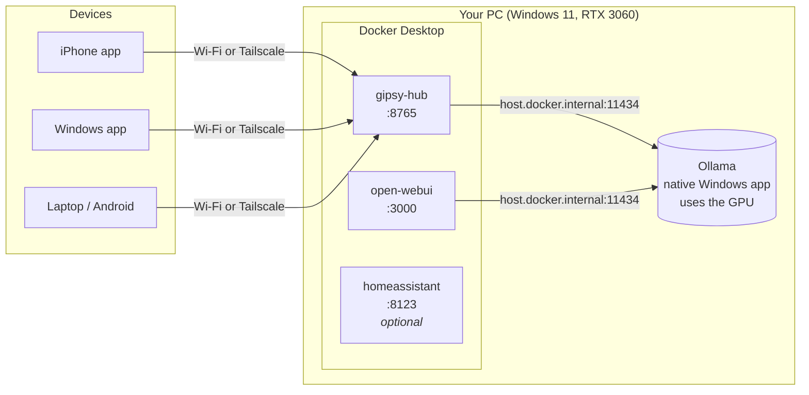

# Running Gipsy's AI stack with Docker

This is the "everything in boxes" way to run Gipsy on the PC. Each piece runs in its own **container**, which is like a small sealed computer with only that one program inside. You can start, stop, update or delete any piece without touching the rest of Windows, and one command brings the whole stack up.



| Piece | Where it runs | What it does |
|---|---|---|
| **Ollama** | Normal Windows app (not Docker) | Runs the Qwen3 models on the GPU. Kept outside Docker because that's the simplest way to give it the graphics card. |
| **gipsy-hub** | Container | The server the Gipsy apps talk to: chat, voice, Whisper, tools, the markets library. |
| **open-webui** | Container | A ChatGPT-style web page for every model in Ollama. Good for testing models side by side. |
| **homeassistant** | Container, off by default | Smart plugs, the lamp and Alexa later on. |

**Privacy:** the models and your conversations never leave the PC. The only things that go out to the internet are the lookups you ask for (news, prices, web search) and the one-time downloads of the containers, the voice and the Whisper model. Open WebUI's telemetry is switched off in `docker-compose.yml`, and in the Ollama app you can leave **Cloud** turned off in Settings.

---

## One-time setup (about 20 minutes)

### 1. Install Docker Desktop

1. Download **Docker Desktop for Windows** from docker.com and run the installer. Keep the **"Use WSL 2"** option ticked.
2. Restart the PC when it asks.
3. Open Docker Desktop once and wait until the bottom-left corner says **Engine running**. You can skip signing in.
4. Optional: in Docker Desktop → Settings → General, tick **"Start Docker Desktop when you sign in"** so Gipsy comes back after a reboot.

> Docker Desktop is free for personal use and education.

### 2. Make sure Ollama is running

The Ollama app should already be in your system tray (bottom right, near the clock) with the models pulled:

```powershell
ollama pull qwen3:8b
ollama pull qwen3:14b
ollama pull nomic-embed-text
```

### 3. Get the code onto the PC

Open **PowerShell** (press the Windows key, type `powershell`, press Enter) and run these one line at a time:

```powershell
D:
cd \
git clone https://github.com/jnguyen-tech/gipsy.git
cd gipsy
```

No `git`? Install it from git-scm.com (all the default options are fine), close PowerShell, open it again and repeat. You can also download the repo as a ZIP from GitHub (green **Code** button → **Download ZIP**) and unzip it to `D:\gipsy`.

### 4. Create your settings file

Still in PowerShell, inside `D:\gipsy`:

```powershell
copy .env.example .env
notepad .env
```

The defaults work as they are. The one line worth changing is `TZ` (your time zone). Save and close Notepad.

### 5. Start everything

```powershell
docker compose up -d
```

* `up` means "start the stack", and `-d` means "in the background, so I can close this window".
* The first run takes 5 to 10 minutes: it builds the Gipsy Hub container and downloads Open WebUI. After that it starts in seconds.

Check that it's running:

```powershell
docker compose ps
```

You should see `gipsy-hub` and `open-webui` with a status of **Up** (the hub says **healthy** after about a minute).

### 6. Let your phone in (Windows Firewall)

Docker Desktop normally asks Windows for permission the first time. If your phone can't reach the hub, run this once in PowerShell **as administrator** (right-click PowerShell → Run as administrator). It opens port 8765 on your *private* home network only, never on public Wi-Fi:

```powershell
New-NetFirewallRule -DisplayName "Gipsy Hub (Docker)" -Direction Inbound -Protocol TCP -LocalPort 8765 -Action Allow -Profile Private
```

### 7. Try it

| Open this | You should see |
|---|---|
| http://localhost:8765/api/health | `"ollama": true` and your models listed |
| http://localhost:3000 | Open WebUI. Create an account: the first one becomes the admin. |

In the Gipsy app's Settings, the Home Wi-Fi address is the PC's Wi-Fi IP with port 8765, for example `http://192.168.1.50:8765`. To find the IP, run `ipconfig` and look for **IPv4 Address** under your Wi-Fi or Ethernet adapter. On the PC itself, `http://127.0.0.1:8765` works too. Tailscale works the same way as before: `http://100.x.y.z:8765`.

> **Already ran the hub the old way (start_hub.bat)?** Close that window first. Both can't use port 8765 at the same time.

---

## Everyday commands

Run these in PowerShell from `D:\gipsy`.

| I want to... | Command |
|---|---|
| Start everything | `docker compose up -d` |
| Stop everything | `docker compose down` |
| See what's running | `docker compose ps` |
| Watch the hub's log live (Ctrl+C to stop watching) | `docker compose logs -f hub` |
| Restart the hub after editing its settings | `docker compose restart hub` |
| Update after pulling new code | `git pull` then `docker compose up -d --build` |
| Update Open WebUI | `docker compose pull open-webui` then `docker compose up -d` |
| Turn on Home Assistant too | `docker compose --profile home up -d` |
| Stop only Open WebUI | `docker compose stop open-webui` |

`docker compose down` stops and removes the containers, but **keeps your data** (settings, voices, Open WebUI chats). Nothing is lost.

Docker Desktop's window shows the same thing with buttons: the **Containers** tab lists the `gipsy` stack with start, stop and log buttons for each piece.

## Where your data lives

| What | Where |
|---|---|
| Hub settings (`config.json`), voice files, `hub.log` | `D:\gipsy\docker-data\hub\` |
| Your own lessons for the markets library | `D:\gipsy\gipsy_hub\knowledge\` (add `.md` files, then restart the hub) |
| Kaiju battle song | Put the file in `D:\gipsy\docker-data\music\`, then in `config.json` set `"kaiju_song_path": "/music/battle-song.mp3"` |
| Whisper model, Open WebUI chats and accounts | Docker volumes `gipsy_whisper-models` and `gipsy_open-webui` (Docker Desktop → Volumes) |
| Home Assistant | `D:\gipsy\docker-data\homeassistant\` |

`docker-data` and `.env` are in `.gitignore`, so your settings and song never get pushed to the public repo.

Inside the container the hub sees its folders as `/data`, `/music` and `/app/knowledge`. That's why paths in the Docker `config.json` look like `/music/...` instead of `D:\...`.

## Who can reach what

| Port | Default | Reachable from |
|---|---|---|
| 8765 hub | `HUB_BIND=0.0.0.0` | This PC, your home Wi-Fi, your Tailscale devices |
| 3000 Open WebUI | `WEBUI_BIND=127.0.0.1` | This PC only. Set `WEBUI_BIND=0.0.0.0` in `.env` to use it from your phone. |
| 8123 Home Assistant | `HA_BIND=0.0.0.0` | This PC and your home network |

Your router keeps all of these off the public internet. For extra safety, set `api_key` in `docker-data\hub\config.json` to a password, and enter the same one in each Gipsy app. After you've made your Open WebUI account, set `WEBUI_ALLOW_SIGNUP=False` in `.env` and run `docker compose up -d` so nobody else can sign up.

## Troubleshooting

**`"ollama": false` in /api/health.** Check that the Ollama app is running (llama icon in the tray). If it is, open Ollama's Settings and turn on **"Expose Ollama to the network"**, then restart Ollama. Some setups need this so containers can reach it. Windows Firewall still keeps it to your private network.

**`docker` is not recognized.** Docker Desktop isn't running, or PowerShell was open before you installed it. Start Docker Desktop, wait for "Engine running", then open a new PowerShell window.

**"port is already allocated".** Something else is using that port, most often `start_hub.bat` still running. Close it, or change `HUB_PORT` in `.env`.

**The first voice reply is slow.** The first start downloads the Piper voice (about 60 MB) and Whisper (about 150 MB). Watch progress with `docker compose logs -f hub`.

**I want to start fresh.** `docker compose down -v` also deletes the volumes (Open WebUI accounts and chats, the Whisper download). Your `docker-data` folder stays until you delete it yourself.

## Why Ollama isn't in a container

Ollama can run in Docker with GPU access, but on Windows that needs the NVIDIA container toolkit inside WSL and adds a layer to debug. The native Windows app already uses the RTX 3060 with no setup. The containers reach it through `host.docker.internal`, a special name Docker Desktop gives the Windows host. If you later move Gipsy to an always-on Linux mini PC, the same `docker-compose.yml` works there: set `OLLAMA_URL` in `.env` to wherever Ollama runs.
